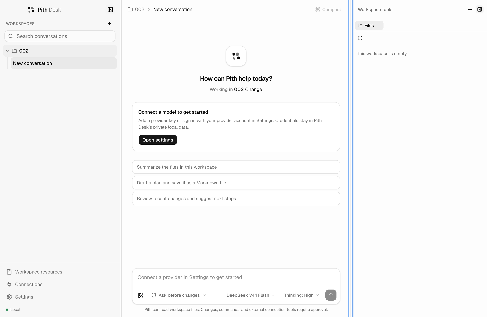
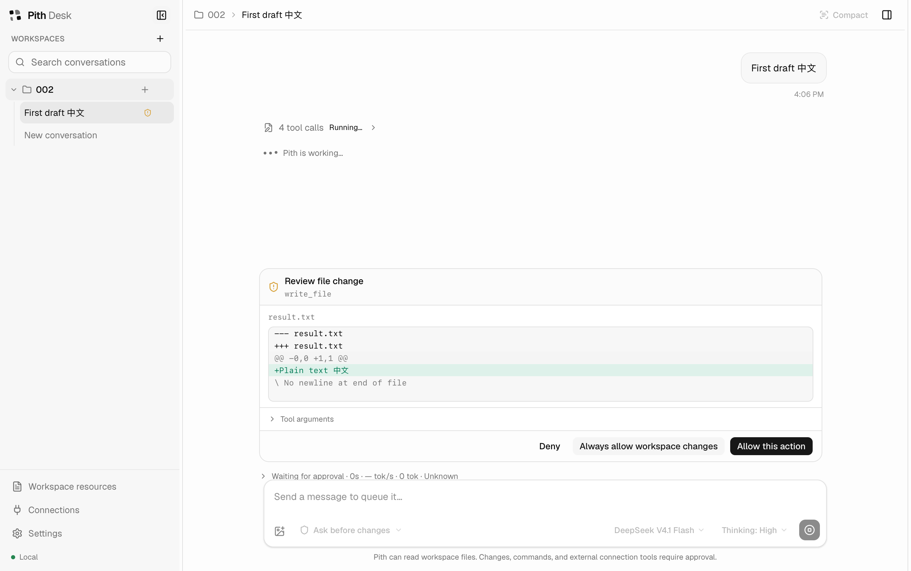
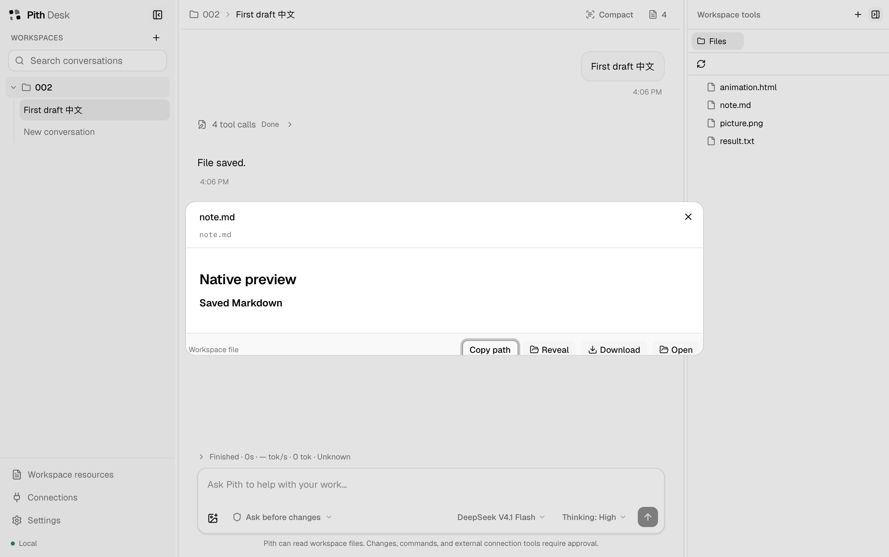

# Pith Desk

A workspace for getting things done with an AI agent, available as a native **Desktop** app or a headless **Server** accessed through your browser. Bring your model connection, choose a folder, and work through conversations, files and reviewed tool actions.



*Current macOS desktop in Light appearance. All screenshots use demonstration workspaces and conversation data.*

- **Workspace conversations:** streamed replies, text and image drafts, searchable history, branches and concurrent tasks in separate folders.
- **Review before changes:** file diffs and tool approvals, with permission settings for each conversation.
- **Files beside the conversation:** preview Markdown, text and images; open, reveal, copy or save workspace files.
- **Your model connections:** provider API keys, supported OAuth flows, independent compatible endpoints and optional MCP tools. DeepSeek Flash is the default model.
- **Task visibility:** pending messages, timing, usage and cost estimates, with interrupted tasks saved for review.

Pith Desk uses [Pith](https://github.com/minifish-org/pith) as a versioned Go library and [MyGo](https://github.com/egoist/mygo) for the native macOS and Linux windows, with a TypeScript interface. Agent behavior, provider adapters and model capabilities come from Pith. See [SDK integration](docs/SDK_FEATURES.md) for the reused capabilities and their boundaries.

## Try it

Download the Apple Silicon (ARM64) or Ubuntu x86-64 preview from [Releases](https://github.com/minifish-org/pith-desk/releases). On Mac, open the `darwin-arm64.tar.gz` and move **Pith Desk.app** to Applications; the same package serves automatic updates. The Mac preview is ad-hoc signed and **not notarized**; see [opening instructions](docs/RELEASING.md#manual-installation). On Ubuntu, extract `linux-amd64.tar.gz` into its own user-writable directory and run `./pith-desk`; the same archive serves in-app updates. See [Ubuntu dependencies and installation](docs/RELEASING.md#ubuntu-preview). Building from source remains an option for development.

The preview includes the Pith Desk icon in Finder and the Dock, with a matching
favicon for Server mode.

On macOS, open the built **Pith Desk.app**. You do not need Go, Node.js or npm to run the packaged application.

1. Choose a workspace folder.
2. Open Settings, choose a provider and enter its API key, or use **Sign in with provider** when Pith offers OAuth. The default endpoint is filled in automatically; **Advanced connection settings** lets you override it. Use **Test connection** to check streaming and tool calling using that provider’s last selected model or Pith’s default, then Save settings. Testing sends one small model request, does not save the form, and never accesses workspace files or executes tools.
3. Choose a model and thinking effort beside the message box. Create a conversation and ask the agent to inspect or change files in that folder.
4. Review the tool name and arguments before approving a file change or command. You can change the permission mode beside the message box. Use Stop to cancel a running task.

For a safe first task, choose an empty test folder and ask: “Create a short welcome.md that explains what you can do in this workspace.”

The application saves settings and conversation data in your user configuration directory (`~/Library/Application Support/Pith Desk` on macOS). The key is stored in a private local file, not in the frontend, URLs or the repository. This version does not use macOS Keychain.

### Providers, models and thinking effort

**Settings** manages independent model connections. Choose a built-in provider and save its key or sign in through its SDK OAuth flow. **Add independent model connection** gives another endpoint its own name, protocol, models and credentials. Official OpenAI and several OpenAI-compatible endpoints can coexist. API base URL is prefilled and hidden under
**Advanced connection settings** for proxies and custom services. Saving another
provider’s connection does not change the active conversation model. Pith supplies the catalog, input
capabilities, context/output limits, and supported thinking levels. The model
list is the catalog bundled with the pinned Pith SDK, **not** a live list of
models authorized for your account. Updating the SDK updates this catalog.
The endpoint override must speak the selected model's native protocol.

The model button beside the composer opens a searchable
picker for configured providers. The thinking selector only shows levels that
Pith says the selected model supports, including `max` when available. Models
with no reasoning support hide that control. Changes apply to the next task;
stop all running tasks before changing the shared model or effort. The run details record
the provider and effort actually selected for that task.

Each provider retains its own endpoint, key and last selection. Switching
providers restores those settings. Changing an endpoint requires entering the
key again: a saved credential is never silently forwarded to a new address.
Custom connections have their own model IDs, capabilities, limits and optional
USD prices. Blank prices mean unknown; explicit zero prices mean free. A blank
key on a custom connection sends the SDK adapters a non-secret `unused` key,
which is suitable only for servers that ignore authentication.

Agent requests, connection probes and context summaries all use Pith's native
adapters. Desk does not implement separate OpenAI, Anthropic or Google clients.
OAuth availability comes from the selected SDK provider. The sign-in dialog
opens the provider page and forwards device codes or additional prompts; tokens
are saved by Pith and refreshed for subsequent requests. OAuth uses the official
provider endpoint, not a custom proxy. Cloud credential setups such as Bedrock,
Vertex and Azure are not configured by this UI.

### Appearance

Open **Settings → Appearance** to choose **Light**, **Dark**, or **Follow system**. Light uses a porcelain background with an indigo accent; Dark uses graphite with an ice-blue accent. Follow system is the default and responds to changes in your operating system's appearance while the app is open. Manual choices override the system until you select Follow system again.

Appearance changes apply immediately, including during an agent task, and are saved in the local settings file for the next launch. Native window controls follow the same preference. Model settings and conversation permissions are independent of appearance.



*Dark appearance with a file change ready for review.*

### Conversation permissions

Each new conversation starts with **Ask before changes**. Reads and searches can run without a prompt; file changes and commands need a decision.

File-change approvals show the workspace path and a colored diff for creates,
overwrites and multi-block edits. **Tool arguments** retains the complete
request. Large or non-text changes fall back to the arguments with an
explanation. If a previewed file changes while waiting, approving refreshes
the diff and requires another decision before execution or a lasting grant.

- **Allow workspace changes** lets file tools create and edit files inside the selected workspace without asking each time. Commands still need approval. A file-change approval card also offers **Always allow workspace changes** for that conversation.
- **Full access** also lets commands and enabled MCP tools run without individual approval. Choosing this mode requires explicit confirmation because commands and external tools can access data beyond the workspace. There is no operating-system sandbox.

The choice is saved for that conversation and survives restarting the app. It does not apply to other conversations. Change back to **Ask before changes** to require approval for future changes; revoking permission does not undo an action already executing.

### Continue a running task

While Pith is working, the send button becomes **Stop** when the composer is empty. Adding text or images switches it back to send; sending a message queues it for when the current task would otherwise finish. In **Pending messages**, edit or delete individual messages, or click **Steer** to turn one into an **Instruction** for the next turn boundary. Steering waits for the current model response and tool batch; it does not interrupt a running command. Editing preserves attached images. Messages already received by the agent cannot be edited or deleted. Stop cancels the task and clears its pending messages; they are not carried into a later task or another conversation.

Closing the desktop window or pressing `⌘Q` asks for confirmation when any workspace has an active task, including one waiting for approval. **Keep working** leaves those tasks running; it is the default when you press Return. **Stop tasks and quit** interrupts all tasks and exits the app. An idle app closes immediately. In this preview, Escape does not dismiss the confirmation; use **Keep working** or Return.

### Run status and recovery

Expand the status line above the composer to see the running model, Pith session token usage, estimated conversation context, context summary count, recorded tool failures and estimated cost. Expand **Request breakdown** within those statistics for each reported request, including retries and context summaries, with input/output/cache tokens, purpose, status, saved rates and price source. Model retries and context summarization have their own status. Conversation context excludes system instructions and tool schemas. Costs are USD estimates from the bundled Pith/Pi catalog or custom prices, not the provider bill. Requests with unknown usage or prices are excluded from totals. No external pricing or exchange-rate API is called. Earlier requests made before the ledger was added are not reconstructed.

Expand a **Command** tool entry to see its exact command text, initial working directory and output. Its header shows **Running**, **Completed** or **Failed**, and the details survive reopening the conversation. A numeric exit code appears only when supplied as structured tool-result metadata. The current pinned Pith SDK does not supply one; Pith Desk does not infer it from output or error messages.

The same status line shows the latest task's total elapsed time and average output tokens per second. Time includes tools, approval waits, retries and context summaries; speed uses that task's reported output tokens (including reasoning), excluding input, cache and earlier tasks. It is a task average, not instantaneous model decoding speed. Completed and stopped timing survives reopening. Old runs without timing show **Not recorded**; interrupted checkpoints show a lower-bound duration and no speed, excluding app downtime.

Failures show guidance for credentials, unknown models, incompatible endpoints, network interruptions, rate limits, summarization and local errors. **Review and continue** sends an explicit new instruction using the existing Pith transcript. It does not replay the original task or automatically restart actions after a crash. Review already completed or uncertain external actions first. After changing model settings, test the connection before continuing.

Run metadata is saved beside the sessions. After an interrupted shutdown, the conversation is marked for review when reopened. Settings and failure cards offer **Save diagnostics** through a native save dialog. The JSON contains version/platform information, counts, usage and failure category; it excludes prompts, transcript text, file contents, local paths, endpoint URLs, tool arguments and credentials.

For newly admitted tasks, recovery also records where the conversation stood
before admission. If shutdown happens before the new request reaches its history,
**Review and continue** includes that saved text and its images. Requests already
in history are not added twice; recovery still requires the user's explicit action.

### Conversations and files

The sidebar groups conversations under their workspace folders. Expand or collapse a folder, or use its new-conversation button to start a chat in that workspace. Search conversation titles across workspaces. Each conversation's `…` menu can rename, export or permanently delete that conversation without opening it first. Desktop exports open a native save dialog so you can choose the destination. Titles are recorded through Pith's session API; the desktop catalog indexes them.

The desktop window shares its native titlebar with the conversation header.
Native window buttons remain available, and empty header areas drag the window.

An expanded sidebar keeps its compact collapse icon at its own top: navigation
beside the brand (in the native window-controls row on macOS), tools beside its
tabs. Once collapsed, the corresponding left/right end of the conversation
header shows its opener. On wide screens the sides open independently and the
conversation expands into the available space. Column headers share one compact
row height: 44px in browsers, or the native window-controls height when taller.
Opening or closing a sidebar does not change that height. On phones each side is an
overlay: only one opens at a time. Close it with its top icon, shaded backdrop
or Escape; focus returns to its opener. Tab and Shift+Tab stay inside an open
phone panel, while focused terminal programs retain their own keys.

Drag the left rail's right edge or the right rail's left edge to resize them
independently. Focus the separator with Tab and use Left/Right for 10px steps,
Shift+Left/Right for 40px steps, or Home/End for its limits. Navigation normally
ranges from 200–480px and tools from 240–800px. Smaller windows temporarily
constrain both rails to retain at least 320px for the conversation; enlarging
the window restores the preference. Narrow screens continue to use overlays.
Files and terminal columns adapt live without replacing their views or shells.
Completed adjustments are saved with Desk settings in its data directory,
survive collapse, refresh and app/service restart, and apply to the controlling
page in both Desktop and Server. A viewport constraint is never saved as a
new preference. These widths are shared by workspaces in that Desk profile.

The right tool rail opens with one **Files** tab. Use the adjacent **+** menu for
**New files**, **New terminal** or **New Web**. Files and terminal tabs retain their content when switched or
hidden. Each workspace restores its own tabs and selection after refresh;
each Files tab keeps its expanded directories and reading position.
These preferences are local to the browser/profile. Closing Files destroys only
that view. Closing every tab leaves an empty rail with the **+** menu available.

**Files** lists the selected folder's immediate directories and files.
Expand a directory to read its contents on demand; safe links inside the
workspace can also be expanded. The compact row above the tree contains the
workspace path and **Refresh workspace files**. Large directory listings stop
at 10,000 entries and show a limit notice. Use Refresh after the Agent or another
program changes files; it reloads the root and expanded folders. Older saved
file-name filters are ignored while expansion and reading positions still restore.

Click a file for the existing online preview. Its **File actions** menu offers
Preview, Download, Copy path and **Insert reference**. In Desktop it also retains
Open, Reveal and Copy file. Download uses the native save dialog in Desktop and
the browser in Server. Insert reference adds the quoted workspace-relative path
at the message selection, keeping the rest of the draft and its images; it does
not submit a message. Switching workspaces closes the preview and shows that
workspace's retained tool views.
The conversation's edited-files card still represents successful Agent file
writes/edits, independently of this directory browser.

Text and image drafts are saved automatically in the private application data profile,
separately for each conversation. Switching conversations or restarting the
app restores the draft. A workspace with no conversation can retain its own
initial draft. Sending or queueing successfully clears only the submitted,
unchanged draft; a rejected request keeps it. Drafts are not sent to the model
or added to the transcript until submitted. Removing a conversation or
workspace also removes its drafts. Text drafts have an 8 MiB limit; image
attachments use the upload limits described below.

### Web preview

Choose **+ → New Web** in the existing right tool rail. Each **Web** tab has an
HTTP/HTTPS address and a refresh icon. Enter an address and press Return;
right-click Refresh (or use Shift+F10) for **Open externally**. Multiple Web tabs
remain independent. Addresses, contents and credentials are not saved in
conversations or layout storage.

In **Desktop**, the tool rail surrounds an independent MyGo native WebView. Websites and localhost load directly. Switching tabs/workspaces or
hiding tools retains the page; closing its tab releases it. Resizing the rail
resizes the native page. Desk dialogs and popovers temporarily hide it so they
keep their existing focus and interaction. Native page permissions and automatic
downloads are denied. HTTP/HTTPS popup links open externally after the same URL
checks. Desk's own ports stay blocked.

In **Server**, every address opens a new tab in your browser, without an extension.
Ordinary websites, public IPs and LAN IPs open directly without a Go fetch. For a
local project, start its dev server in a manual terminal and enter, for example,
`http://localhost:5173`. Here localhost means the **Server machine**. Only these
loopback addresses use the existing Go reverse proxy; the new tab receives an
authorized proxy URL, never the client's localhost.

Each proxied preview has a separate origin and its own HttpOnly authorization
cookie. Opening another preview, refreshing a Web tool, switching workspaces,
hiding tools, closing a Web tool or refreshing Desk does not revoke other preview
tabs. The controlling Server lease owns authorization: takeover, logout, lease
expiry, workspace removal or explicit API revocation ends the relevant HTTP,
streaming and WebSocket access. Closing Desk eventually expires its lease.
Closing a browser preview tab alone does not release the controlling Desk lease.

The proxy preserves nested paths, root-relative resources, streaming and Vite
WebSocket HMR. `localhost` tries literal `::1` and `127.0.0.1` without DNS; explicit
loopback IPs use only their interface. HTTP and HTTPS retain normal default ports
and certificate validation. The proxy pins one loopback host/port, rejects
Desk/frontend/preview ports, strips incoming cookies, Authorization and
Desk/forwarding headers, and strips project Set-Cookie/Clear-Site-Data responses.
It preserves upstream CSP and X-Frame-Options. Response sandbox and permission
policies retain the project restrictions previously supplied by the iframe;
workers/service workers, downloads, popups and native permissions remain blocked.
Project scripts cannot read Desk's document, storage or credentials.

HMR must use the page origin; hard-coded socket origins and additional backend
ports are not rewritten. Projects requiring cookie login or untrusted local
certificates need their own secure development access. URL credentials are
rejected. Remote HTTPS Server use requires the
[separate preview hostname setup](#https-reverse-proxy). **Open externally** uses
the authorized proxy origin in Server and the project address in Desktop.
These are user-operated previews; they add no Agent browser automation.

The preview controls and tool rail are part of the source-controlled frontend.
Normal builds and releases use that embedded UI; `--dev-url` only serves it from a
loopback Vite server during development.

### Manual terminal

Choose **+ → New terminal** in the right tool rail to start a shell immediately.
Each Terminal tab owns an independent shell, environment, current directory and
process session (up to 16 retained terminal sessions per service). Hiding the rail,
switching tabs/workspaces, closing the page, logging out or losing the connection
does not stop the shell. Refresh/reconnect attaches to that same session while
the same Go service is running. An exited shell stays exited; close it before
starting another. The Terminal tab's **×** stops its shell and foreground/background
jobs. Removing the workspace or exiting the service also cleans them up.
Explicitly detached processes that start a different OS session are outside this
terminal's process session and may outlive it.

Hover a tab for the Local/Server location, host name, initial absolute directory
and shell; the tab bar has no permanent location badge. The shell's `pwd` shows
its current directory after `cd`; the initial-directory tooltip remains the
workspace path. The host account's executable `$SHELL` is preferred, then its
account configuration and `/bin/zsh`, `/bin/bash`, `/bin/sh` fallbacks, in
interactive mode. macOS and Linux require a usable shell and PTY support
(`/dev/ptmx`/`devpts` in Linux containers). Programs such as vim/top must be
installed on that host. The embedded frontend uses pinned `@xterm/xterm` and
`@xterm/addon-fit`; Go uses `github.com/creack/pty`. Running a packaged Desktop
or headless Server needs no Node.js, terminal service or extra daemon. Existing
GUI-free Linux Server and `CGO_ENABLED=0` builds remain supported.

Select text and use standard Copy/Paste shortcuts or the system context menu.
Paste/input messages are limited to 16 KiB. On phones and touch layouts, compact
bottom controls provide Ctrl+C (interrupt), Escape,
Tab, arrows and Ctrl+D. Keyboard shortcuts stay in the focused terminal; Escape
is delivered to terminal programs, so use **Close tools** or the backdrop to
dismiss a phone overlay. Short keyboard viewports retain the emulator and touch
keys. Desktop keeps those buttons hidden. Conversation drafts and file-browser
positions stay intact across tool switches.

**This is a host-account shell, not a workspace sandbox.** The workspace is only
its initial directory. A signed-in Server controller can execute commands with
the server account's permissions, including access beyond the workspace.
Creation, reads, input, resize and close use the existing authentication and
exclusive page lease; takeover revokes the old socket and rejects late controls.
Shell environment construction allows ordinary identity, PATH, locale and
temporary-directory values; it does not inherit application login tokens, model
keys or MCP credentials. Your shell startup files still run as your host account
and can load its configuration or credentials.

The Agent continues using its existing `run_command`, permission and approval
flow. Its working directory, environment and processes are separate. Both can
change the workspace files; there is no input arbitration or Agent terminal
tool. Terminal input/output/history is never automatically added to Agent
context. Review files yourself when running commands alongside an Agent task.

Output travels on a separate authenticated WebSocket and is acknowledged after
xterm parses each block; terminal traffic does not update application snapshots.
Go continues draining output without a browser into a **1 MiB byte ring** per
session; the emulator keeps **1,000 scrollback lines**. A slow page may lose old
output rather than accumulate unbounded buffers. Reconnect resets the emulator
and replays the retained bytes; truncation displays an explicit notice. Input is
disabled while disconnected/restoring and is never queued for retransmission.
Commands near a disconnection may already have reached the shell: inspect before
typing them again.

Replay is a bounded raw stream, not a saved terminal screen. Reconnect requests
a foreground-program redraw, including when dimensions stay the same. vim/top
receive focused automated browser checks; truncation inside control sequences,
old size-dependent output, alternate-screen state outside the ring and programs
that ignore resize/redraw can leave an incomplete display. Use the program's
redraw command (for example Ctrl+L or vim `:redraw!`) when needed. Service restart
does not restore shells or re-execute commands. There is no multi-user sharing,
cross-instance recovery, terminal recording, sandbox or Agent takeover feature.
Only tab layout and Files preferences enter browser storage; terminal input,
output and history do not. A new browser/profile can discover the running
workspace sessions, but has its own layout. Saved terminal tabs whose service
has restarted show that the session ended; creating a new tab starts a new shell.
Phone soft-keyboard checks are automated simulations; physical iOS/Android
keyboard, selection handles and system clipboard behavior still need device
acceptance.

Pith Desk supports **concurrent tasks in separate workspace folders**. Add folders, create conversations and switch views while other tasks continue in the background. The sidebar marks each running conversation and shows when it needs approval. Stop, pending input, permissions and run statistics belong to that conversation. A workspace can run one task at a time; nested or overlapping workspace folders share that restriction. An occupied workspace offers **Open running conversation**. Global model, credential and MCP connection changes require all tasks to stop. See [workspace concurrency](docs/WORKSPACE_CONCURRENCY.md) for the execution contract and validation.

The sidebar shows a small blue spinning ring for running tasks and an amber approval icon when a decision is needed. The ring indicates activity, without estimating progress. A completed task leaves a blue unread dot until its conversation is viewed. Completion in another conversation shows an in-app notice; when the desktop app is in the background, it sends a silent macOS notification instead. Both offer navigation to the completed conversation. System notifications require OS permission and remain subject to Focus and screen-sharing rules.

The macOS app retains notification targets across launches.
Clicking a valid older notification starts or activates the packaged app and
opens its workspace conversation. Targets expire after 90 days, a newer
completed run in the same conversation, or removal of the conversation/workspace;
at most 512 are retained. An unavailable target shows a short explanation. macOS
starts the normal application data profile; custom `--data-dir` profiles must be
reopened with the same argument before clicking. The OS does not replay launch
arguments.

The native **File** menu provides **New Conversation** (`Cmd/Ctrl+N`),
**Choose Workspace…** (`Cmd/Ctrl+O`) and **Export Current Conversation…**
(`Cmd/Ctrl+Shift+E`). **Settings…** uses `Cmd/Ctrl+,`; macOS places it in the
application menu. The standard edit, view, window and quit controls remain.
Page actions wait for loading, requests and dialogs; export is disabled for the
current running or approval-pending conversation. Opening settings and choosing
another workspace remain available while tasks run. Configuration changes and
quit confirmation retain their existing rules.

**Delete conversation** permanently removes its local session history, image attachments and run receipt. **Remove workspace**, in the folder's `…` menu, unlinks the folder and deletes all its conversations and related application data. Both require confirmation. A running conversation cannot be deleted; a workspace with an active task or overlapping active folder cannot be removed. Unrelated idle conversations remain manageable while other tasks run. Workspace folders and their files—including files created by Pith and exported documents—are never deleted. There is no archive or restore feature. Removing a folder leaves no dangling conversations.

Deletion intent is saved before the catalog changes. If cleanup is interrupted, Pith Desk retries committed deletions on startup; uncommitted requests leave their conversation data intact. Cleanup errors are reported and never treated as a successful deletion.

Press `⌘N` to start a conversation in the current workspace.

**Copy response** appears under each agent message once that message stops
streaming. Copy includes that message's complete original text and Markdown.
The branch action appears under completed agent replies.
User messages have **Copy message** and **Edit message** actions. Edit a message
and choose **Send again** to replace it and its following replies in the active
branch. Attached images are retained, and the original version remains in
conversation history. Editing is available while the conversation is idle.
User and agent messages show their recorded time in your local timezone; hover
over the time to see the full date and time.
Each fenced code block also has **Copy**, which copies only that block's literal
code, including its line breaks. This is available in Markdown file previews too.

Use **Cmd/Ctrl+F** to find text in the current conversation, including folded
tool results. **Enter** and **Shift+Enter** move between matches; **Esc** closes
search. Sidebar search continues to search conversation titles.
Switching conversations remembers each conversation's reading position and
expanded tool results for the current app session. New output follows the bottom
when you are already there; when reading earlier content, **Back to latest**
returns to the end.

After a task finishes, successful file writes and edits appear in an edited-files card at the end of the conversation. The card shows the number of changed files, their total added and removed lines, and up to four files with each file's own line changes; **Show all N files** expands the list and **Show fewer files** collapses it again. Selecting a file opens its recorded changes as a diff; the **Diff**/**File** switch shows the complete current file, and files changed before diffs were recorded fall back to the file. In the desktop app the preview also opens the file in its default application, reveals it in Finder, downloads it and copies its path; in Server the preview offers Download and Copy path. Missing files, failed changes, and files outside the workspace are excluded. Files created by arbitrary shell commands are not automatically detected.

Local file links in replies open **Save file** in the desktop app, or download in
Server. They can save Word, PDF and other regular workspace files,
including files generated by scripts that do not appear in the file list. Links
keep the workspace of their conversation and cannot read outside it or private
application storage. Cancelling leaves the file in place.

**Preview** opens the file in a dialog within Desk: PNG, JPEG, GIF and WebP
images up to 50 MiB, rendered Markdown, and UTF-8 text. Long text previews show
the first 8 MiB in pages of up to 256 KiB. Large Markdown previews use paged source
text; smaller Markdown previews retain formatted rendering. HTML and SVG source
appear as text; scripts and external images do not run in the preview. Use **Open** to view an animation or other
file in its associated application. Preview reads the current recorded file
through the same workspace checks as the existing file actions.



*Preview a generated file without leaving the conversation.*

Drop existing files from the selected workspace into the message area to insert editable, workspace-relative paths. Multiple files, spaces and Chinese names are supported. These are plain Markdown path references; dropping them does not import or read their contents. Images keep their existing attachment behavior. Browser preview can validate complete local file URIs; when the browser hides the path, type the relative path or use the desktop app.

On macOS, the Dock shows **!** for pending approval or the number of conversations with completed unread results across all workspaces. Approval takes priority over unread results. Ordinary running tasks do not add a Dock badge. Unread counts remain until the corresponding results are viewed, survive app restarts, and show **99+** above 99 conversations. With no approvals or unread results, the Dock badge stays empty. Other platforms retain the in-app task indicators.

### Workspace instructions, skills and prompt templates

Open **Workspace resources** to inspect the files discovered by Pith. Instructions
include AGENTS.md and CLAUDE.md along the ancestor path; project skills live in
`.pi/skills`, and prompt templates in `.pi/prompts`. View, create, edit or delete
project resources in the Markdown editor. If an existing file cannot be read,
the editor stays read-only until **Retry loading** succeeds. Inherited instructions
are read-only here. Changes load on the next task. **Use** inserts `/skill:name` or `/name` into
the composer; Pith expands the resource and template arguments when submitted.

The application retains Pith's instruction and skill discovery. Skill references to the `read` tool are mapped in the desktop prompt to its guarded `read_file` tool. No separate skill engine or visual workflow builder is used.

### MCP connections

Open **Connections** to configure an HTTP endpoint or an installed local MCP server command. HTTP connections accept an optional bearer token; an empty token field preserves the saved token. Local commands accept an argument array and optional environment overrides as a JSON object of string values. Blank overrides preserve saved values; use the clear checkbox to remove them. Only saved variable names are displayed. Enable only the connections you want available, then connect explicitly or let the next task connect them. Connection status and tool counts appear in the dialog.

Pith provides the MCP transports, discovery, OAuth and calls. Desk saves connection settings, supplies sign-in UI and applies approvals. Enabled MCP tools are registered as deferred: the model starts with `tool_search`, and selected schemas become available on demand. Connecting still discovers the server catalog; deferred exposure saves model context rather than avoiding that initial catalog request. **Ask before changes** and **Allow workspace changes** both require approval for external MCP calls. **Full access** also authorizes tools from enabled connections. Connection changes and disconnects require all running tasks to finish or stop first.

Tokens and environment overrides are saved in the private local `mcp.json` file and their values are never returned in public configuration responses. This client does not install MCP servers or bundle their Node/Python runtimes. HTTP MCP connections can use the SDK OAuth flow instead of a bearer token, with optional client ID and scope. Sign in, then connect or reconnect to load tools. The temporary callback uses `127.0.0.1:54819`; the port must be available. External servers decide whether they support discovery and dynamic client registration. A connector marketplace is outside this version's scope.

### Code mode, history and recovery

**Code mode** is enabled alongside ordinary tools. The agent chooses whether to
compose several tool calls, filter results or return a smaller answer through
Pith's existing JavaScript/WASM runtime. Nested writes, commands and MCP calls
use the same workspace checks and approval rules as direct calls. Successful
nested file writes and edits also appear in the edited-files card and its diffs.
Code mode does not install Node.js and is not an OS sandbox for the tools it invokes.

Use the branch action below a saved assistant reply to continue from that point,
or **Conversation branches** in the conversation's sidebar menu to choose a
saved node. Pith preserves sibling branches in the same session; this does not
undo files, commands or remote effects. **Compact** calls Pith's summarizer,
keeps recent messages and preserves saved history. Short conversations may have
nothing to compress. Compression is a model request and appears in the cost ledger.

Every task is admitted to a Pith Durable JSONL journal before it runs, alongside
pending queued text/images. Restart shows an interrupted task for review; **Continue**
starts a new task over saved history and restores pending queue items. Unfinished
commands or remote effects are never automatically replayed. This is durable
admission, settlement and queue recovery around the coding-agent session, not an
exactly-once guarantee for each external effect or a resumable model stream.
Deleting a conversation also deletes its local cost ledger and durable journal.

## Images

Use **Attach images** in the composer, drag images onto it, or paste a screenshot.
Preview and remove attachments before sending. An image can be sent alone, with
text, or as a queued instruction or next task while the agent is working.
Click a draft attachment, a sent image, or an image in a file preview to enlarge
it. The viewer offers **Fit**, **Original size**, and zoom controls; **Esc** closes
the viewer and returns to the underlying conversation or file preview.

PNG, JPEG, GIF and WebP are accepted, with a **50 MiB total upload limit per
message** to bound local upload memory. Provider limits may be lower. Image
bytes are sent unchanged; this client does not resize or transcode uploads.
Model capability comes from the pinned Pith catalog. Text-only models reject
image inputs before starting a run; a compatible endpoint must actually support
the selected model's image input.

Accepted images are saved inside Pith's local session records, outside the
workspace, and sent to your configured model provider. Unsent image attachments
are saved privately with the text draft and restored when you switch conversations
or restart the app. History previews
are fetched from the authenticated local service; image bytes are not included
in every streaming state update. Guarded workspace image reading is also enabled
for image-capable models. Markdown exports mark image attachments but do not
embed their bytes.

## Server mode

Server uses the same Go service, Pith Agent core, persisted data format and Web UI
as Desktop. It runs without MyGo, a display server, GTK or WebKit. The production
executable embeds the frontend; Go, Node and npm are only needed to build it.

Download `pith-desk-server-<version>-linux-amd64.tar.gz` or
`pith-desk-server-<version>-linux-arm64.tar.gz` and its `.sha256` file from
[Releases](https://github.com/minifish-org/pith-desk/releases). Verify the checksum,
extract into its own directory, and run `./pith-desk-server --data-dir /path/to/private/desk-data`.
See [Server installation](docs/RELEASING.md#linux-server-packages).

To build from source:

```sh
npm ci
npm --prefix frontend ci
npm run build:server
./build/pith-desk-server --data-dir /path/to/private/desk-data
```

Open **http://127.0.0.1:7540**. On first start, Server generates a random token in
`DATA_DIR/server-token` with mode `0600`. Read that file locally and paste its
contents into **Server token** in the browser. The token is never printed in the
page or placed in a URL. Alternatively set `PITH_DESK_TOKEN` to a secret of at
least 32 characters, or supply `--token-file /path/to/private/token`. An existing
token file must be a regular file with no group/other permissions; it is never
overwritten. Restart after rotating the token to invalidate all browser sessions.

| Option | Default | Purpose |
|---|---|---|
| `--listen` | `127.0.0.1:7540` | HTTP listening address |
| `--data-dir` | `Pith Desk Server` under the OS user configuration directory | Private settings, sessions and journals |
| `--origin` | The listener's loopback HTTP origin | Exact public browser origin, e.g. `https://desk.example.com` |
| `--token-file` | `DATA_DIR/server-token` | Login secret when `PITH_DESK_TOKEN` is unset |

Desktop keeps its existing **Pith Desk** directory. To use existing Desktop data
in Server, stop Desktop and pass its data directory explicitly. Both modes use
the existing data lock and file formats; only one process may open that data at
a time. Workspaces are absolute directories **on the server**. Mount or create
those folders before adding them; browser-local folders are not uploaded or
mapped to server folders. Server requires an absolute path, resolves symlinks,
and checks that its OS account can read and traverse the directory. Read-only
workspaces are allowed; individual write operations still check permissions.
The private application data directory cannot be a workspace or sit inside one.
Existing directory aliases, including case variants on macOS, share the same
private-data boundary and task exclusivity. Adding an alias of an existing
workspace reuses that workspace.

### Login, ownership and task lifetime

Login creates a 24-hour HttpOnly, SameSite=Strict browser session; HTTPS origins
also require a Secure cookie. Every business API, image, file download and state
stream additionally requires the active page's exclusive lease. Opening another
tab or browser shows a single **Continue here** button. Clicking it takes control
immediately, revokes the old lease and closes its state streams. Refresh resumes
with a new page credential and restores actual Go-owned task and approval state.
Control handoff also settles already-admitted writes before enabling the new
page. Old or slow-upload requests cannot overwrite the replacement page's data.

A page renews its 45-second lease every 10 seconds. Closing or losing the browser
lets the lease expire. **Continue here** reconnects and takes control immediately;
opening a page or retrying a background connection never steals control
automatically.
Sleeping/throttled browsers may need to reconnect. Closing a page, losing its
lease or signing out never stops an Agent task. Use **Stop** to abort a task.
**Log out** saves drafts, releases the lease and invalidates the current
browser session. Stopping the server interrupts tasks using the same reviewed
recovery behavior as Desktop; it does not automatically replay external effects.

The browser never retries task submissions on reconnect. Server checks operation
numbers for every business mutation: repeated numbers return a retained response
or are rejected after the bounded response window expires, rather than executing
again. These receipts are process/page scoped; they are not an exactly-once
guarantee for a model provider's retries or external tool effects.

Drafts normally autosave to the server. On disconnect or takeover, the old page
becomes read-only and stops its controllers and autosave. Unsaved message text
and open message/queue edits have a text-only recovery copy in that tab's
`sessionStorage`; image data and saved configuration credentials are not copied there. The reconnect
screen lets you select/copy the text. After reload, **Recovered unsent text**
offers a text download and explicit discard. Recovery never submits or replaces
the current server draft: check the actual conversation and queue before sending
anything again. Browser quota, disabled storage or permanently closing a tab can
prevent local recovery; keep the old page open until you have copied its text.

Queue entries, completion/unread flags and pending approvals are server-owned
and survive browser reconnects. Closing a page does not cancel running or queued
work. No browser notification permission or background push service is used.

Conversation exports, diagnostics and file links download through the browser.
Generated files and previews use **Download**; **Copy server path** copies their
absolute server path. Resource **Copy server path** also copies its server
location; View/edit remains in the web UI. **Reveal** is hidden in Server's file list,
preview and resources; Desktop retains its native behavior. Browser clipboard
support requires localhost or HTTPS. Dropping/pasting images still uploads image
attachments. Other browser files and `file://` URLs are never treated as server
paths or uploaded, even if an identical path exists on the server. Use Workspace
files → Insert reference, or type a workspace-relative path in the message.
Workspace files explicitly shows **Server workspace** and **Copy server path**;
directory reads, preview and browser downloads require the current login and
exclusive page lease. A page that loses control stops its file operations.

Model requests, Base URLs (including `localhost`), MCP commands, environment
overrides, runtime dependencies, file tools and approved commands all run on
the **server** under its OS account. Install required MCP executables there.
Credentials retain the existing private configuration/auth stores; APIs return
configuration status and environment key names, never saved secret values.

Native menus, window
controls, notifications, clipboard file references and desktop updating are not
used in Server. Upgrade Server by stopping it, replacing the binary and restarting
with the same private data directory. Back up that directory before upgrading.

### Provider and MCP sign-in

Server reuses the pinned Pith SDK's login, token exchange, refresh and existing
credential storage. It chooses headless methods where available:

| Connection | Remote sign-in |
|---|---|
| Anthropic | Copy-code flow; paste the authorization code back into Desk |
| OpenAI Codex | Device code; authorize on the provider's page |
| OpenAI ChatGPT | Open the provider's page, then paste its complete final redirect URL; the installation ID persists on the server |
| GitHub Copilot | Device code, including the SDK's enterprise-host prompt |
| Kimi Coding, Meta, xAI | Device code |
| Radius | Device code |
| OpenRouter | Manual code or final redirect URL |
| New MCP OAuth authorization | Unavailable remotely: the current flow requires the Desktop loopback callback on port 54819. New login controls are hidden; use an HTTP bearer token instead |

For manual redirect flows, a browser may show a failed localhost callback page:
copy its complete final URL into Desk rather than opening a port on the server.
Saved MCP OAuth settings and credentials are retained, can refresh while valid,
and can be signed out. In an existing connection, turn OAuth off and save a bearer
token to switch authentication explicitly. New SDK flows are hidden until their remote interaction
has been reviewed. Provider availability, account eligibility and authorization
success remain controlled by the provider.

### Phone browsers

The same UI supports narrow screens, a collapsible sidebar, scrollable tool
approval and browser downloads. The shared frame follows the visual viewport
when a keyboard opens, keeps input selection/text, and leaves pinch zoom to the
browser. Use HTTPS for remote clipboard support. Automated Chromium/WebKit checks
cover a phone viewport and simulated keyboard resize; real iOS/Android keyboard
and OS download-sheet behavior still need device acceptance.

### Linux single-binary build

```sh
npm run build:ui
GOWORK=off CGO_ENABLED=0 GOOS=linux GOARCH=amd64 go build -trimpath -o pith-desk-server ./cmd/pith-desk-server
# Use GOARCH=arm64 for an ARM64 Linux host.
./pith-desk-server --listen 127.0.0.1:7540 --data-dir /srv/pith-desk/data
```

Only the executable and a writable data directory are required. No GUI libraries,
Node runtime, separate web server assets, database service or container platform
are required. Keep backups of the data directory and workspace files.
`RELEASE_TAG=v<version> npm run release:server` builds the embedded frontend once
and packages both Linux Server architectures with notices, source/version
metadata and SHA-256 checksums under `build/releases/`.

### HTTPS reverse proxy

For remote access, terminate HTTPS at your existing reverse proxy and set the
exact external origin. Plain HTTP origins are allowed only for localhost.
Server does not trust `X-Forwarded-Host` or `X-Forwarded-Proto`; the proxy must
preserve the external Host header, browser Origin, cookies, and WebSocket
subprotocols. Deploy at the origin root, with no URL prefix.

Identity proxies can return to `/` through a cross-site top-level GET document
navigation after sign-in. Server admits that public entry page while retaining
cross-site rejection for APIs, writes, assets and Desktop. Forward the browser's
Fetch Metadata headers unchanged.

```sh
./pith-desk-server --listen 127.0.0.1:7540 \
  --origin https://desk.example.com --data-dir /srv/pith-desk/data
```

For example, inside an existing Nginx HTTPS server block:

```nginx
location / {
    proxy_pass http://127.0.0.1:7540;
    proxy_http_version 1.1;
    proxy_set_header Host $http_host;
    proxy_set_header Upgrade $http_upgrade;
    proxy_set_header Connection "upgrade";
    proxy_buffering off;
    proxy_read_timeout 3600s;
    client_max_body_size 128m;
}
```

The backend can bind another interface with `--listen 0.0.0.0:7540 --origin
https://desk.example.com` when the proxy runs elsewhere. Restrict direct backend
access to that proxy. The configured HTTPS origin always issues Secure cookies;
opening its backend HTTP address directly is intentionally rejected. Token login
is for one trusted self-hosting user, with full access to the configured server
account's Agent capabilities. It is not multi-user isolation.

For **server-local web previews**, also route `*.preview.example.com` to a
separate listener in the same Go process. Configure wildcard DNS and a matching
TLS certificate on your existing proxy. Preview cookies are first-party in the
new browser tab; no iframe cookie exceptions or browser extensions are required. Do not use
Desk's own hostname or strip the random preview subdomain from Host.

```sh
./pith-desk-server --listen 127.0.0.1:7540 \
  --origin https://desk.example.com --data-dir /srv/pith-desk/data \
  --preview-listen 127.0.0.1:7541 --preview-origin https://preview.example.com
```

In the wildcard HTTPS block, use `server_name *.preview.example.com;` and the
same location settings above, changing only `proxy_pass` to
`http://127.0.0.1:7541`. Preserve Host, Origin, WebSocket Upgrade and subprotocols;
disable response buffering for streams. Each preview gets a fresh random
subdomain, so a retired page cannot inherit a subsequent lease's credentials.
Only independently authorized, current-lease grants are admitted. The server never starts or publishes a
project automatically; projects can remain bound to loopback.
Without this setup, external websites still open in new tabs; server-local
preview requests explain the missing configuration.

## Develop

Long-term ownership, local development and validation conventions are in
[AGENTS.md](AGENTS.md); commands and preparation are documented below and in
[Testing](docs/TESTING.md).

Requirements: Go 1.27.1 or later, Node.js 22.12 or later, npm, and macOS 12 or later on Apple Silicon.

```sh
npm ci
npm --prefix frontend ci
npm run dev
```

`dev` starts Vite and the native desktop window with frontend hot reload, `GOWORK=off` and CGO disabled. CSS updates in place; TypeScript changes reload the interface. Restart the command after Go changes. The same development UI can be inspected in a browser:

```sh
npm run dev:server
```

Open the loopback URL printed by the Server process, then sign in with its token
file. Both development commands default to **Pith Desk Development** under the
system configuration directory, separate from the installed Desktop and Server
profiles. They build the embedded assets if missing, then serve frontend edits and
Vite HMR through the shared Host. Server development uses the same Token login
and exclusive lease checks as the embedded production UI. Restart after Go
changes. Use different `--data-dir` values when running both commands together.
Development rejects paths overlapping the default production profiles, including
symlink aliases. Use disposable workspaces for mutating tests.

### Frontend development

The shared Web UI is source-controlled in `frontend/src` and runs in both modes.
It uses React 19 with Vite, Tailwind CSS v4 and shadcn/ui (Nova, Radix), Lucide
icons, Motion for animation, react-resizable-panels for the rails, dnd-kit for
attachment ordering and Zustand for application state.

Keep requests, permissions, persistence, operation targets and application
coordination in Go and the TypeScript action modules under
`frontend/src/actions`. Components render store state and emit intents. Do not add
a second icon set, animation library, panel implementation, drag library or state
container. shadcn components are checked in under `frontend/src/components/ui`;
restyle them there instead of layering presentation overrides elsewhere.

For a fast type check without bundling or the Go/browser suites:

```sh
npm run check:ui
```

Run the relevant behavior checks for the change, for example
`npm run test:ui -- frontend/e2e/refactor-smoke.spec.ts`. Browser and native
acceptance are separate facts from a successful build.

For an embedded browser check after `npm run build:ui`, run
`GOWORK=off CGO_ENABLED=0 go run ./cmd/pith-desk-server --data-dir /path/to/separate/test-data`.
There are exactly two modes: Desktop and Server. The old `--preview` flag and
`npm run preview` entry have been removed. Packaged executables use embedded
assets and never start Vite. `--dev-url` is loopback-only and must not be used for
remote deployments.

HTTP requests, queries, responses and streamed State types come from Go's
`internal/wire` registry and JSON tags. Run `npm run generate:contract` after a
schema change; `npm run check:contract` rejects stale generated TypeScript or
host route drift. `build:ui` and the CI check run this check automatically.
Desktop retains the authenticated loopback transport; Server uses its cookie and
page lease for HTTP/WebSocket access. Opaque SDK JSON remains `unknown`; business
validation stays in the service.

Read the frontend along its data flow:

| Entry | Responsibility |
|---|---|
| `main.tsx` → `app.ts` | Start the page, attach Desktop/Server lifecycle adapters, and receive ordered HTTP/WebSocket snapshots. |
| `stores/desk.ts` | Project the latest Host snapshot and hold shared transient UI state. |
| `actions/` | Own typed requests, business coordination, original operation targets and persistence, grouped by domain. Use the generated contract types rather than copying request shapes. |
| `stores/workspace-tools.ts` + `actions/workspace-tools.ts` | Keep each workspace's tool layout and pending closes independent; preserve the saved tab format and apply async results to the original workspace's current layout. |
| `App.tsx` → `components/workspace-layout.tsx` | Compose the shell, conversation, composer and tool rails. Dialogs are dispatched by `components/dialogs/registry.tsx`. |
| `components/` + `hooks/` | Render state and emit intents; own local disclosure, focus and rendering lifetimes. A scoped async read must retire when its target or view changes. |
| `lib/derive.ts`, `lib/permissions.ts`, `lib/events.ts` | Pure snapshot projections, permission metadata and typed page-local signals. |

Native adapters under `frontend/src/lib` validate events and forward data without
finding or changing UI nodes. The titlebar
overlay follows `--mygo-titlebar-height` and `--mygo-titlebar-inset-*`, and marks
only drag regions with `--app-region`.

### CI checks and caches

`Check / mac` always reports a result, including for documentation-only PRs.
There are no workflow-level path filters. PRs use their base diff: documentation
checks whitespace without dependency installation; frontend changes run the
frontend/tool tests and both browser engines. Dependencies, public transport,
Go code, build/workflow configuration and unknown paths or missing history run
the complete suite. Every main push and manual run uses complete validation.
Only superseded PR runs are canceled automatically.

Inspect the committed PR range locally, or run the frontend portion separately:

```sh
node --experimental-strip-types scripts/ci-scope.ts pull_request origin/main
npm run check:frontend
```

The complete CI sequence installs the root and frontend dependencies once,
builds UI assets and the browser Host fixture once, runs frontend/tool tests, vet, all Go packages once with
race detection, both browser engines and Linux amd64/arm64 compilation of
Desktop and Server. The Server compilation also produces and validates the two
release archives. To reproduce the check commands after installation:

```sh
npm run check:frontend
GOWORK=off CGO_ENABLED=0 go vet ./...
GOWORK=off CGO_ENABLED=1 go test -count=1 -race -p 1 ./...
npx --no-install playwright install --only-shell chromium webkit
npm run test:ui
```

For a browser-only run that also shares one compiled Host across workers:

```sh
GOWORK=off CGO_ENABLED=0 go build -o /tmp/pith-desk-host-fixture ./internal/testsupport/hostfixture
PITH_DESK_HOST_FIXTURE=/tmp/pith-desk-host-fixture npm run test:ui
```

The shared binary comes from this checkout; each test still starts an isolated
Host process and data directory. Omitting the variable retains worker-local
compilation for ordinary local browser runs.

CI uses Chromium's Headless Shell and WebKit; it does not download the unused
full Chrome binary. Both browser projects remain in the suite. Install full
Chromium separately when using Playwright's headed local tools.
The macOS browser cache (`~/Library/Caches/ms-playwright`) is restored by
Playwright version, macOS major version and runner architecture. The install
step still checks the restored engines and downloads only missing engines. A new
Playwright/platform combination or an evicted cache needs a fresh download;
cache hits never skip browser tests.

`npm run check` remains the local complete build/unit/ordinary-Go/vet shortcut;
CI uses the race run in place of repeating those Go tests. npm caches downloads
for both lockfiles. The Go cache includes modules and compiled ordinary, race
and embedded packages, keyed by platform, toolchain, dependency checksum and
commit, with compatible restore prefixes so new compiled work can be saved.
Tests still execute with `-count=1`; generated UI and binaries are not restored
as validation output. Release packaging still requires a successful complete
Check on the exact main commit. Native acceptance remains a separate check.

Inspect execution and queue times separately with
`gh run view RUN_ID --json createdAt,jobs`. Cache hits and selective PR savings
must be measured, rather than inferred from skipped command counts.

## Build a Mac application

```sh
npm run build
```

The local build creates an application bundle under `build/`. It uses ad-hoc signing and skips notarization and DMG generation. Developer ID signing and notarization are separate release steps for distributing outside this machine. `npm run build` uses the current host architecture; `npm run build:mac` and Mac release packaging target Apple Silicon (ARM64). Source builds on Intel Mac are outside the supported scope.

```sh
npm --prefix frontend run build
GOWORK=off CGO_ENABLED=0 go test ./...
GOWORK=off CGO_ENABLED=0 go vet ./...
```

Both Pith and MyGo are pinned in `go.mod`; applications build without a sibling checkout or a local Go replacement. Release checks use `GOWORK=off` to verify the versioned dependency. See [SDK dependency validation](docs/SDK_FEATURES.md#versioned-sdk-dependency). Node/npm are development tools only. The Mac window uses the system WKWebView, which may have its own helper processes.

## Where to read the code

- `frontend/src/`: React application, streamed state, actions, native adapters and the checked-in shadcn components.
- `frontend/src/stores/desk.ts`: the single Zustand projection of the Host snapshot and transient UI state.
- `frontend/src/actions/`: requests, business coordination and persistence.
- `frontend/src/components/`: shell, conversation, composer, dialogs, tools and settings composition.
- `internal/desk/`: the application service and its Pith SDK adapter, persisted settings/history and tool policy.
- `internal/host/`: shared embedded frontend/API, Desktop authentication, Server sessions/leases and streamed snapshots.
- `internal/wire/` and `cmd/contractgen/`: Go request/response schemas and generated TypeScript contracts.
- `cmd/pith-desk/`: the native window, folder picker and Desktop lifetime.
- `cmd/pith-desk-server/`: headless listener, Token configuration and Server lifetime.
- `mygo.config.ts`: build and packaging settings.

The Go service owns each agent run. Closing a browser subscription does not end a run. **Stop** aborts it explicitly; application shutdown preserves an unfinished durable task for user-reviewed recovery. The frontend only renders snapshots and submits user actions.

See [testing and native smoke checks](docs/TESTING.md) for verification and a short manual checklist.

## Current boundaries

Desktop and Server are experimental single-user products. It has no built-in computer-control tools, plugin marketplace, scheduled jobs or enterprise account system yet. Recovery requires user review and cannot roll back or deduplicate external effects.

Workspace checks are an application tool policy, **not an operating-system sandbox**. File tools reject paths outside the workspace. An approved command can access the computer with your account's permissions; examine it before allowing it. Model requests send the conversation and tool results to your configured provider. See [security and data handling](docs/SECURITY.md).

Pith Desk publishes Desktop previews for macOS on Apple Silicon (ARM64) and Ubuntu x86-64, and headless Server packages for Linux amd64/arm64. The Ubuntu desktop is validated on Ubuntu 26.04 with XFCE; GTK 3 and WebKitGTK 4.1 are Desktop runtime dependencies. Linux ARM64 Desktop remains compile-only. Intel Mac and Windows are outside the supported scope. For end users, downloadable packages are the intended delivery path; building from source is a development option. Mac and Linux Desktop portable releases offer **Settings → Updates → Update and restart**, with confirmation when tasks are running and a writable app location required. Server upgrades replace the stopped executable manually. Linux releases use portable archives; Debian packages are no longer published. See [release packaging and signing](docs/RELEASING.md).

The interface draws on the workspace-and-conversation layout of DeepSeek Harness, but uses its own host and Pith SDK integration. It does not load Harness plugins or copy its application runtime.

## License

Pith Desk is licensed under the [GNU Affero General Public License v3](LICENSE), consistent with its Pith dependency. Dependency notices are in [docs/THIRD_PARTY.md](docs/THIRD_PARTY.md). See [CONTRIBUTING.md](CONTRIBUTING.md) for development and contribution guidance, and [SECURITY.md](SECURITY.md) for private security reporting.
